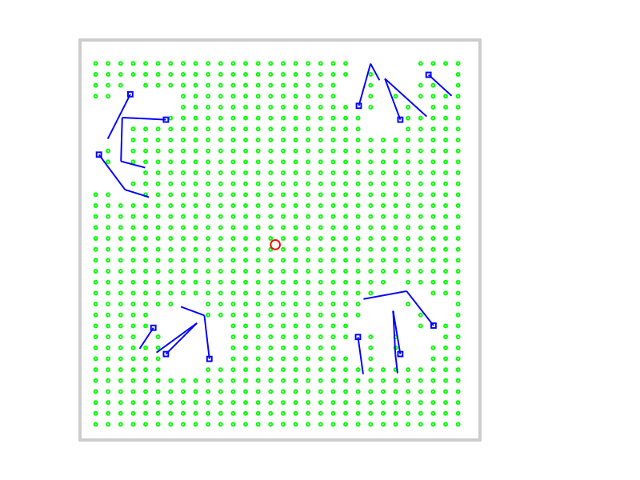

# Microrécif

Simulation interactive d'un écosystème marin en 2D, développée en C++17 avec
GTKmm 4 et Cairo. Les algues apparaissent et vieillissent, les coraux se nourrissent
et se reproduisent, et les scavengers consomment les coraux morts.



## Fonctionnalités

- Simulation en continu ou pas à pas.
- Croissance et reproduction des coraux, avec détection des collisions.
- Attribution des coraux morts aux scavengers les plus proches, avec un seul
  scavenger par cible.
- Activation de la naissance aléatoire des algues.
- Chargement et sauvegarde de l'état du monde dans des fichiers texte.
- Interface redimensionnable, compteurs de population et raccourcis clavier.

## Installation

Prérequis : un compilateur C++17, Make, pkg-config et GTKmm 4.
Python 3 est nécessaire pour les tests.

### macOS

Installer les outils de développement Apple si nécessaire :

```sh
xcode-select --install
```

Installer les dépendances avec Homebrew :

```sh
brew install gtkmm4 pkg-config python
```

### Ubuntu / Debian

```sh
sudo apt install build-essential pkg-config libgtkmm-4.0-dev python3
```

## Lancement

Depuis la racine du projet :

```sh
make
make demo
```

La démonstration démarre en pause. Cocher **Naissance d'algue**, puis cliquer sur
**Start**. Les coraux vivants sont bleus, les coraux morts noirs, les algues vertes
et les scavengers rouges. Un écosystème peut s'éteindre lorsque les organismes
atteignent leur durée de vie maximale.

Pour ouvrir un autre monde ou démarrer avec une fenêtre vide :

```sh
./projet tests/t41.txt
./projet
```

| Commande | Action | Raccourci |
| --- | --- | --- |
| Start / Stop | Démarrer ou suspendre l'évolution | `s` |
| Step | Avancer d'un pas lorsque la simulation est arrêtée | `1` |
| Open | Charger un fichier de simulation | — |
| Save | Sauvegarder l'état courant | — |
| Exit | Fermer l'application | `q` |

Open et Save mettent la simulation en pause. Le délai entre deux pas est réglé
par `speed_time_ms` dans `gui.cc` : 10 ms par défaut, soit environ 100 pas par
seconde selon la charge de calcul. Après modification, relancer `make` et rouvrir
l'application.

## Scénarios

| Fichier | Comportement à observer |
| --- | --- |
| `examples/recif.txt` | Monde peuplé avec des coraux jeunes |
| `tests/t36.txt` | Consommation d'une algue et croissance au deuxième pas |
| `tests/t41.txt` | Naissance d'un corail, puis ajout d'un segment |
| `tests/t42.txt` | Annulation d'une croissance contre le bord du monde |
| `tests/t44.txt` | Alimentation et reproduction des scavengers |

## Tests

```sh
make test
make test-sanitize
```

Les tests s'exécutent sans fenêtre ni dépendance GTK. Ils couvrent les 47 fichiers
de référence, les 15 messages attendus, la géométrie, l'évolution des populations,
l'attribution des cibles et la relecture des sauvegardes. Les scénarios valides
sont également exécutés pendant 10, 100 et 2 000 pas avec naissance d'algues.

`test-sanitize` utilise AddressSanitizer et UndefinedBehaviorSanitizer avec GCC
ou Clang. La détection des fuites est désactivée pour cette cible.

```sh
make clean
```

Cette commande supprime l'exécutable principal et les fichiers objets. Les
exécutables de tests et leurs symboles de débogage sont exclus de Git par
`.gitignore`.

## Organisation

| Fichiers | Rôle |
| --- | --- |
| `projet.cc` | Point d'entrée |
| `gui.*` | Interface GTK et temporisateur |
| `simulation.*` | Évolution, chargement et sauvegarde |
| `lifeform.*` | Algues, coraux et scavengers |
| `shape.*` | Géométrie et collisions |
| `graphic.*`, `graphic_gui.h` | Dessin Cairo |
| `constantes.h`, `message.*` | Paramètres du modèle et diagnostics |
| `examples/` | Monde de démonstration |
| `tests/` | Scénarios et tests automatiques |
| `docs/` | Architecture, format des fichiers et illustrations |

- [Architecture et règles du modèle](docs/architecture.md)
- [Format des fichiers de simulation](docs/file-format.md)
- [Organisation des tests](tests/README.md)

## Auteurs

Antoine Bernadat et Timothy Biersohn.

Projet de programmation orientée objet réalisé en BA2, puis enrichi d'une suite
de tests et d'une attribution exclusive des cibles aux scavengers.
