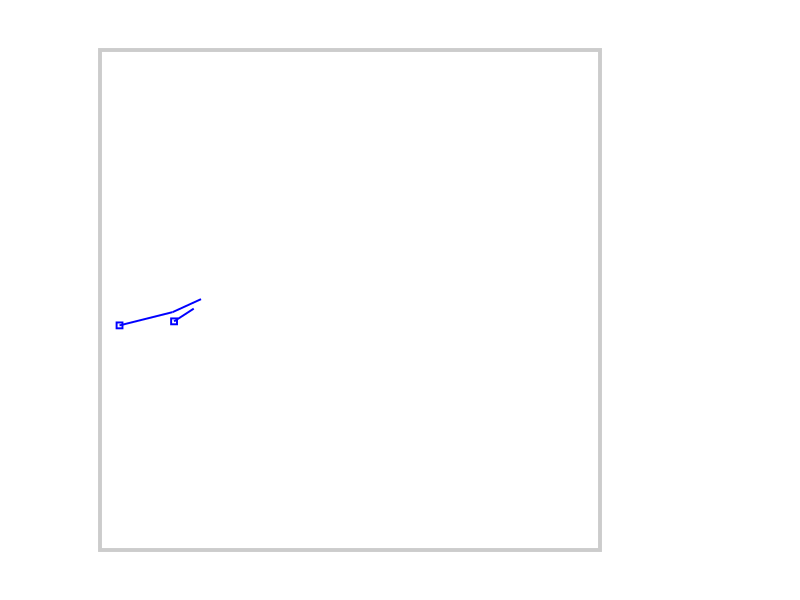

# Architecture

## Modules

Le programme sépare l'interface, le modèle et le dessin.

- `projet` crée l'application et transmet le fichier initial optionnel.
- `gui` gère les commandes, le temporisateur, les compteurs et le cadrage.
- `simulation` possède les populations et coordonne leur évolution.
- `lifeform` définit `Entite`, `Algue`, `Corail` et `Scavengers`.
- `shape` représente les segments et calcule les intersections.
- `graphic` fournit les primitives de dessin Cairo.
- `message` centralise les diagnostics des fichiers de simulation.

Le modèle peut être compilé sans GTK. Le pilote de tests remplace les primitives
de dessin par des fonctions vides et utilise les mêmes sources que l'application.

## Mise à jour

Un pas traite les algues, les coraux, puis les scavengers. Les naissances de coraux
et de scavengers sont ajoutées après les parcours en cours pour éviter d'invalider
les références aux éléments des vecteurs.

### Algues

Les algues vieillissent et disparaissent à leur âge maximal. Si la génération est
activée, un tirage détermine la naissance d'une algue à une position aléatoire.
Le générateur est réinitialisé avec la graine 1 à chaque chargement.

### Coraux

Seul le dernier segment d'un corail vivant tourne. Il balaie au maximum 0,0625 rad
par pas, soit environ 3,58°. Parmi les algues à portée, la première rencontrée dans
le sens de rotation est consommée et le segment s'allonge de 4 unités.

Si la rotation ou la croissance produit une collision, l'état précédent est
restauré, l'algue reste présente et le sens de rotation est inversé. Le segment
mobile n'est pas testé contre lui-même ; son voisin articulé est contrôlé par
l'angle de superposition.

À une longueur de 40, le corail alterne entre deux transformations :

| État | Transformation | État suivant |
| --- | --- | --- |
| EXTEND | Réduction du segment à 28, puis ajout d'un segment de 12 | REPRO |
| REPRO | Création d'un corail de 12 à 28 unités de la base du segment, puis réduction du parent à 20 | EXTEND |

Le nombre de segments est calculé depuis leur vecteur. Les coraux morts restent
immobiles et continuent de participer aux collisions.

### Scavengers

Les couples corail mort / scavenger libre sont triés par distance croissante à
l'extrémité du corail. Chaque cible et chaque scavenger sont attribués au plus une
fois. Les coraux déjà consommés sont exclus de cette recherche. En cas d'égalité,
l'identifiant du corail puis l'ordre des scavengers déterminent l'attribution.

L'attribution est recalculée au début de chaque pas. Les candidats sans cible
restent immobiles. Un scavenger avance de 4 unités au maximum et commence à manger
au pas suivant son arrivée.

Chaque repas réduit le dernier segment de 4 et augmente le rayon de 1. À un rayon
de 10, le parent retrouve un rayon de 3 et un descendant apparaît derrière lui.
Les segments entièrement consommés sont retirés ; le corail disparaît lorsqu'il
n'a plus de segment.

Cette attribution exclusive est une variante du modèle pédagogique initial, où
chaque scavenger libre recherchait indépendamment sa cible et où plusieurs
scavengers pouvaient converger vers le même corail.

## Fichiers et géométrie

Chaque lecture réinitialise le modèle. Une erreur laisse un monde vide et permet
un nouveau chargement. Les sauvegardes utilisent `max_digits10` pour préserver les
coordonnées lors de leur relecture.

La marge `epsil_zero` s'applique pendant l'évolution. À la lecture, une tolérance
numérique de 1e-10 absorbe les erreurs d'arrondi des calculs d'intersection.

## Complexité

Avec A algues, C coraux, M segments et S scavengers :

| Opération | Coût maximal |
| --- | --- |
| Validation des intersections à la lecture | O(M²) |
| Recherche des algues | O(CA) par pas |
| Collisions des effecteurs | O(CM) par pas |
| Tri des candidats scavengers / coraux | O(SC log(SC)) par pas |
| Mémoire temporaire d'attribution | O(SC) |
| Mémoire des populations | O(A + M + S) |

## Affichage

Le dessin utilise un fond blanc et une projection qui conserve les proportions
lorsque la fenêtre est redimensionnée. Les compteurs réservent une largeur stable
pour éviter de déplacer le dessin lorsque les nombres changent.

Le temporisateur est déconnecté à l'arrêt et à la fermeture. L'ouverture et la
sauvegarde suspendent également l'évolution. Les illustrations de cette
documentation sont rendues avec les primitives Cairo du projet.
